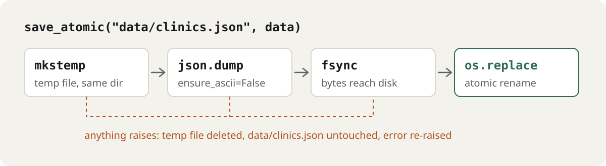

# Design notes

If you read one thing: nothing is configured at import time, a corrupt file raises instead of
reading as empty, a save is atomic, a re-scrape never overwrites a non-empty field, and `rich` is
optional at runtime, not only at install time.

The JSON store is where the originals lost data. dental-parser wrote the file with a plain
`json.dump`, so a crash mid-write truncated the only copy of an hour-long scrape. Its reader had
`except: pass`, so a corrupt file read as "no data" and the next save replaced it with an emptier
one. `save_atomic` now writes like this:

<picture>
  <source media="(max-width: 600px) and (prefers-color-scheme: dark)" srcset="https://raw.githubusercontent.com/octrow/pycommons/main/assets/readme/save-atomic-mobile-dark.svg">
  <source media="(max-width: 600px)" srcset="https://raw.githubusercontent.com/octrow/pycommons/main/assets/readme/save-atomic-mobile-light.svg">
  <source media="(prefers-color-scheme: dark)" srcset="https://raw.githubusercontent.com/octrow/pycommons/main/assets/readme/save-atomic-dark.svg">
  
</picture>

The temp name is unique per call, so two concurrent writers can't rename each other's half-written
file into place.

`setup_logging` has production defaults, each with an opt-out kwarg:

- the persistent file is a `RotatingFileHandler` (`persistent_max_bytes=10 MiB`, `persistent_backups=5`);
- uncaught exceptions in the main thread (CRITICAL) and worker threads (ERROR) are logged with
  their traceback, then passed to the previous hook (`catch_uncaught=True`);
- `warnings.warn` goes to the file (`capture_warnings=True`);
- values of `*TOKEN*` / `*SECRET*` / `*KEY*` / `*PASSWORD*` / `*HASH*` env vars (8+ chars) and
  `Bearer <token>` show up as `***` in every handler (`redact=True`; the env is read once per call).

## Specs

The specs in `openspec/specs/` define the behaviour: 22 requirements, 67 scenarios. Each
requirement says why it exists and, where there was one, which bug in the original copy put it
there. Changes are proposed against them.

One spec per module: [logsetup](../openspec/specs/logsetup/spec.md), [env](../openspec/specs/env/spec.md), [db](../openspec/specs/db/spec.md), [json-store](../openspec/specs/json-store/spec.md), [text](../openspec/specs/text/spec.md).

```bash
openspec list --specs                  # requirement counts
openspec show logsetup                 # read one
openspec validate --specs --strict     # check them
```

## More setup_logging setups

```python
# tiktok-lazy-follower / get_cool_event: rich console + DEBUG file
log_path = setup_logging("tlf", cfg.logs_dir)

# dialogue-lens: files only, persistent + per-run
setup_logging("dialogue_lens", "logs", console_level=None,
              persistent_file="dialogue-lens.log", run_prefix="run-")

# jobs: root logger, plain console, plus jobspy's non-propagating loggers
setup_logging("", "logs", rich=False, run_prefix="run_", attach=["JobSpy:*"])
```

## Output from a real session

```python
>>> safe_filename("Клиника «Улыбка»")      # keeps Unicode and case
'Клиника_Улыбка'
>>> slugify("Ivan P. Sidorov")             # ASCII, lowercase
'ivan-p-sidorov'
>>> slugify("Иван Сидоров")                # non-ASCII is dropped, not transliterated
'x'
>>> merge_keep_nonempty({"phone": "+7 701", "rating": 4.1},
...                     {"phone": "", "rating": 4.6}, always=("rating",))
{'phone': '+7 701', 'rating': 4.6}
>>> load_or_default("corrupt.json", [])
json.decoder.JSONDecodeError: Expecting property name enclosed in double quotes: line 1 column 2 (char 1)
```

## Optional rich

`rich` is imported inside the function. Without it you get a plain `StreamHandler`, so installing bare is fine.

## Tests

105 tests, no network, no real `logs/` directory (everything goes to `tmp_path`). The rich-absent
branch is covered by monkeypatching `builtins.__import__`, so the stdlib fallback is tested with
rich installed.
